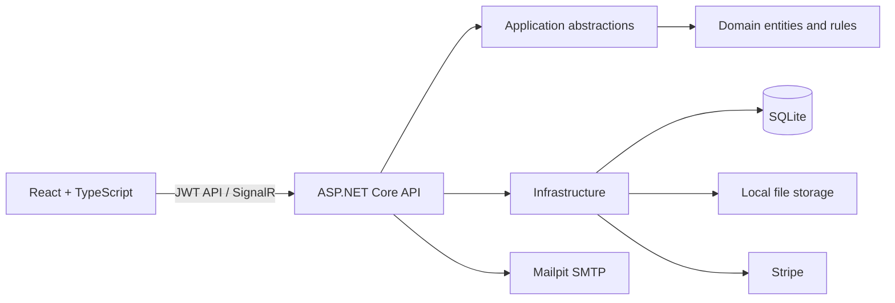

# Clientry

Clientry is a client portal concept for small service businesses. It brings project progress, conversations, files, and invoices into one calm, responsive workspace instead of scattering them across email and chat.

## What is included

- Four-project .NET solution with a domain layer, application abstractions, EF Core infrastructure, and ASP.NET Core API.
- SQLite persistence with EF Core migrations and demo seed data, JWT authentication, role checks, login throttling/lockout, tenant query filters, and resource-scoped file, invoice, project, and comment endpoints.
- Project milestones and progress, comments with SignalR project groups, restricted local file uploads/downloads, generated invoice PDFs, and Stripe PaymentIntent/webhook handling.
- Administrator client lifecycle management: search/paged client list, create/update, activation, client details, user status controls, and per-client invitations.
- Client owners can invite colleagues and deactivate members inside their own client workspace; client members can view the team but cannot manage access or billing. Administrators can view member roles and reassign the owner.
- Project administration: searchable, filterable, sortable paged project lists; project edits and status/archive transitions; milestone CRUD, completion, ordering, and per-project activity history.
- Project files can be uploaded, downloaded, renamed, and removed by their uploader or an administrator; project comments can be edited or removed by their author or an administrator, with activity and SignalR updates.
- Invoice administration supports draft creation/editing/deletion, valid status transitions, verified-payment-only completion, PDF downloads, and CSV export.
- User-scoped notifications provide a filtered inbox, read/unread controls, deep links, and account-persisted in-app and email preferences for project updates, comments, approvals, invoices, and requests.
- Clients can submit and track work requests with up to three validated attachments; administrators can filter the requests inbox, move new requests into review, accept or decline with a response, and convert eligible requests into projects.
- The client home highlights pending approvals, outstanding invoice totals, unread notifications, activity since the user's previous visit, and the next milestone dates; the overview values are queried within the authenticated client's scope.
- Invoice details show line items, tax, discounts, totals, payment history, and status milestones; paid invoices have a QuestPDF receipt, and client owners can maintain the billing information printed on receipts.
- Project files support drag-and-drop or multi-file uploads with per-file progress, authenticated image/PDF previews, uploader grouping, and a scoped ZIP archive download.
- Administrators can persist the workspace display name and support email; client settings remain personal to their account.
- Accounts support profile edits, password changes, and signing out all devices; owners manage client billing and team access, while members can view the team and billing details.
- Client workspace names and support contacts shown in the profile and overview are loaded from the authenticated account and saved workspace configuration; the sign-in page uses illustrative branding rather than sample project records.
- The dashboard uses database-side counts and a six-month payment window; project, invoice, file, comment, activity, invitation, client, and notification collections support bounded pagination, with search or sorting where applicable.
- React + TypeScript frontend for client and admin workspaces, project detail, conversations, files, invoices, client management, invoice administration, and persisted workspace settings.
- Clients can upload/download project files and manage their own files and comments; administrators can manage all project files and comments. Live comment updates are shared with project participants.
- Dockerfiles, Compose services, Mailpit, and GitHub Actions build/test workflow.

## Run locally (under five minutes)

Requirements: .NET 8 SDK, Node 22+, and Docker Compose.

```powershell
Copy-Item .env.example .env
docker compose up --build
```

Open [http://localhost:5173](http://localhost:5173). The API Swagger UI is at [http://localhost:5082/swagger](http://localhost:5082/swagger) in development; Mailpit is at [http://localhost:8025](http://localhost:8025).

For a non-Docker setup:

```powershell
dotnet run --project backend\ClientHub.Api --launch-profile http
cd frontend
npm ci
npm run dev
```

The local Vite server proxies `/api` and `/hubs` to `http://localhost:5082`.

## Demo accounts

All demo accounts use `DemoPass!234`:

| Role | Email |
| --- | --- |
| Agency admin | `admin@demo.com` |
| Client A | `clientA@demo.com` |
| Client B | `clientB@demo.com` |
| Client A member | `clienta.member@demo.com` |
| Client B member | `clientb.member@demo.com` |

Seed data includes two independent client organizations, projects, milestones, comments, and invoices.

## Stripe test payments

Set `STRIPE_SECRET_KEY`, `STRIPE_WEBHOOK_SECRET`, and `VITE_STRIPE_PUBLISHABLE_KEY` in `.env`, then forward Stripe test events to `http://localhost:5082/api/payments/stripe-webhook`. A client can pay a sent invoice from the invoice screen. The invoice is marked paid only after a signature-verified `payment_intent.succeeded` webhook whose amount and currency match the invoice. Use Stripe's test card `4242 4242 4242 4242`, any future expiry, and any CVC.

## Architecture



The repository is organized into `backend/` and `frontend/`. The .NET solution and its projects live in `backend/`; the React application lives in `frontend/`. `ClientHub.Domain` has no project dependencies. `ClientHub.Application` holds service abstractions. `ClientHub.Infrastructure` implements persistence and local file storage. `ClientHub.Api` composes services, authentication, controllers, and SignalR. To switch from SQLite to PostgreSQL, replace `UseSqlite` in API composition with `UseNpgsql`, add the Npgsql EF provider, and review provider-specific migrations; domain and application code remain provider-agnostic.

## Security model

Client identity is issued as a signed `client_id` JWT claim. The scoped request context exposes the claim to EF Core query filters for all client-owned projects, milestones, project files, comments, invoices, invoice lines, payments, and activity records. Notifications are restricted to the authenticated user's own records. Controllers also require authorization, and resource endpoints load through the filtered query before any file is opened or invoice PDF is rendered; a resource belonging to another client therefore appears as not found. File paths are opaque generated identifiers and never returned to the browser. Uploads are limited to 10 MB and an extension/content-type/signature allow-list.

Admin-only endpoints require the Admin role. SignalR project membership is checked against the same filtered project query before a connection is added to its group. Payment status is changed only after Stripe signature verification and amount/currency checks. Production deployments must configure a random `Jwt__SigningKey`, HTTPS, SMTP, and Stripe secrets outside source control.

Authentication supports administrator-issued, seven-day invitations, one-time password reset links, password changes, profile updates, logout, and rotating 30-day refresh tokens. Only token hashes are persisted; access JWTs expire after 15 minutes. Open self-registration is disabled unless `Auth__AllowSelfRegistration=true`. Invitation and password-reset emails use the configured SMTP server; set `FRONTEND_BASE_URL` to the deployed client URL.

## Initial audit

- **Exists:** The backend is split into domain, application, infrastructure, and API projects; EF Core migrations manage SQLite; JWT roles and login lockout protect API routes; client-owned projects, milestones, files, comments, invoices, invoice lines, payments, notifications, and activity are filtered; SignalR checks project access before group membership; Stripe webhooks validate signatures, amount, and currency.
- **Weak, corrected:** Client requests previously had no global filters for users, clients, or invitations, and a client scope missing its `client_id` could match nullable ownership. Filters now cover those entities and fail closed when the claim is absent; the isolation test covers both client separation and missing claims.
- **Weak:** Uploads are limited to PDF, PNG, JPEG, and TXT. Image/PDF signatures are checked, but TXT previously accepted arbitrary binary data. SignalR relies on the global project filter without an explicit client-claim check in the hub.
- **Missing:** Invoice numbering beyond generated unique identifiers and some production-grade frontend flows described in the feature requirements.

## Design decisions and assumptions

- SQLite and local disk are the development defaults. `IFileStorage` is the seam for replacing local disk with S3/Azure Blob.
- One client organization is assigned per client user in the demo; the `Client` entity may own multiple user accounts.
- Invoice currency is currently restricted to USD so Stripe's minor-unit conversion is explicit.
- The default development JWT key is only a local convenience; production fails startup if a key is not configured.
- Self-registration is off by default; client accounts should be created by invitation. Refresh tokens last 30 days and password reset links last one hour.
- The generated UI is intentionally quiet and information-dense: understated indigo accents, readable status, responsive layouts, and reduced-motion support.

## Assumptions

- Only incomplete milestones can be sent for approval. A milestone can be re-requested after changes are requested; an approval decision is accepted only once per pending request. Approval completes the milestone, and a changes request requires a note.
- Clients can cancel a work request only while it is new. Administrators may move new requests into review, decide new or in-review requests with a non-empty response, and convert accepted or in-review requests into projects. Request attachments use the existing 10 MB project-file allow-list and are limited to three per request.
- The client home overview uses the authenticated user's previous overview visit; for a first visit it treats the prior seven days as the activity window, then persists the current visit timestamp.
- Project file archives are limited to 50 MB of uncompressed content. Only PNG, JPEG, and PDF previews are served inline with `nosniff`; other file types remain downloads.
- Invoice discount and tax values are fixed currency amounts entered by the agency; the supported invoice currency remains USD. Billing email addresses are separated by commas or semicolons and limited to five addresses.
- The first client user is Owner; subsequent invited users are Members. Owners can invite and deactivate Members but cannot deactivate themselves or another Owner. Administrator reassignment promotes one active user and demotes the prior owner to Member.

## Client guide

Sign in with a client demo account from the Demo accounts table, or accept an invitation from the agency or your client Owner. Your workspace opens on **Home**, where pending approvals, unpaid invoices, unread notifications, recent project activity, and upcoming milestones are summarized.

- **Projects:** Open a project to follow milestones, review activity, comment, preview supported images or PDFs, upload files, or download the project archive.
- **Approvals:** Approve a pending milestone to mark it complete, or request changes with a note for the agency.
- **Requests:** Create a work request, attach up to three files, track its status and agency response, and cancel it while it is new.
- **Invoices:** Review line items, taxes, discounts, payments, and status history. Pay an eligible invoice or download its receipt after it is paid.
- **Team and billing:** Owners can invite colleagues, deactivate Members, and update billing details. Members can view workspace billing details but cannot change them or manage team access.
- **Notifications and account:** Filter and mark notifications read, follow their links to the related workspace item, edit your profile, change your password, update notification preferences, and sign out of all devices.

Administrators manage client records, projects, milestones, invoices, and work requests from their separate workspace. Client accounts cannot access administrator-only routes or another client's data.

## Current limitations

This repository is a working portfolio foundation, not a fully production-ready implementation of every feature in the original specification. Email queue/retries and scheduled reminders, invoice numbers beyond generated unique identifiers, and end-to-end Docker validation are not implemented yet. Mailpit is available in Compose for invitation and password-reset mail. Docker is needed to verify the composed stack and is not available in the authoring environment.
