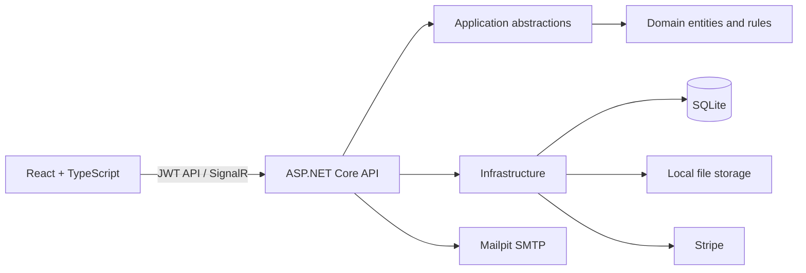

# Clientry

Clientry is a client portal concept for small service businesses. It brings project progress, conversations, files, and invoices into one calm, responsive workspace instead of scattering them across email and chat.

## What is included

- Four-project .NET solution with a domain layer, application abstractions, EF Core infrastructure, and ASP.NET Core API.
- SQLite persistence with EF Core migrations and demo seed data, JWT authentication, role checks, login throttling/lockout, tenant query filters, and resource-scoped file, invoice, project, and comment endpoints.
- Project milestones and progress, comments with SignalR project groups, restricted local file uploads/downloads, generated invoice PDFs, and Stripe PaymentIntent/webhook handling.
- Administrator client lifecycle management: search/paged client list, create/update, activation, client details, user status controls, and per-client invitations.
- Project administration: searchable, filterable, sortable paged project lists; project edits and status/archive transitions; milestone CRUD, completion, ordering, and per-project activity history.
- Project files can be uploaded, downloaded, renamed, and removed by their uploader or an administrator; project comments can be edited or removed by their author or an administrator, with activity and SignalR updates.
- React + TypeScript frontend for client and admin workspaces, project detail, conversations, files, invoices, and basic admin overview/client list.
- Dockerfiles, Compose services, Mailpit, and GitHub Actions build/test workflow.

## Run locally (under five minutes)

Requirements: .NET 8 SDK, Node 22+, and Docker Compose.

```powershell
Copy-Item .env.example .env
docker compose up --build
```

Open [http://localhost:5173](http://localhost:5173). The API Swagger UI is at [http://localhost:5082/swagger](http://localhost:5082/swagger) in development; Mailpit is at [http://localhost:8025](http://localhost:8025).

For a non-Docker setup:

```powershell
dotnet run --project backend\ClientHub.Api --launch-profile http
cd frontend
npm ci
npm run dev
```

The local Vite server proxies `/api` and `/hubs` to `http://localhost:5082`.

## Demo accounts

All demo accounts use `DemoPass!234`:

| Role | Email |
| --- | --- |
| Agency admin | `admin@demo.com` |
| Client A | `clientA@demo.com` |
| Client B | `clientB@demo.com` |

Seed data includes two independent client organizations, projects, milestones, comments, and invoices.

## Stripe test payments

Set `STRIPE_SECRET_KEY`, `STRIPE_WEBHOOK_SECRET`, and `VITE_STRIPE_PUBLISHABLE_KEY` in `.env`, then forward Stripe test events to `http://localhost:5082/api/payments/stripe-webhook`. A client can pay a sent invoice from the invoice screen. The invoice is marked paid only after a signature-verified `payment_intent.succeeded` webhook whose amount and currency match the invoice. Use Stripe's test card `4242 4242 4242 4242`, any future expiry, and any CVC.

## Architecture



The repository is organized into `backend/` and `frontend/`. The .NET solution and its projects live in `backend/`; the React application lives in `frontend/`. `ClientHub.Domain` has no project dependencies. `ClientHub.Application` holds service abstractions. `ClientHub.Infrastructure` implements persistence and local file storage. `ClientHub.Api` composes services, authentication, controllers, and SignalR. To switch from SQLite to PostgreSQL, replace `UseSqlite` in API composition with `UseNpgsql`, add the Npgsql EF provider, and review provider-specific migrations; domain and application code remain provider-agnostic.

## Security model

Client identity is issued as a signed `client_id` JWT claim. The scoped request context exposes the claim to EF Core query filters for all client-owned projects, milestones, project files, comments, invoices, invoice lines, payments, and activity records. Notifications are restricted to the authenticated user's own records. Controllers also require authorization, and resource endpoints load through the filtered query before any file is opened or invoice PDF is rendered; a resource belonging to another client therefore appears as not found. File paths are opaque generated identifiers and never returned to the browser. Uploads are limited to 10 MB and an extension/content-type/signature allow-list.

Admin-only endpoints require the Admin role. SignalR project membership is checked against the same filtered project query before a connection is added to its group. Payment status is changed only after Stripe signature verification and amount/currency checks. Production deployments must configure a random `Jwt__SigningKey`, HTTPS, SMTP, and Stripe secrets outside source control.

Authentication supports administrator-issued, seven-day invitations, one-time password reset links, password changes, profile updates, logout, and rotating 30-day refresh tokens. Only token hashes are persisted; access JWTs expire after 15 minutes. Open self-registration is disabled unless `Auth__AllowSelfRegistration=true`. Invitation and password-reset emails use the configured SMTP server; set `FRONTEND_BASE_URL` to the deployed client URL.

## Initial audit

- **Exists:** The backend is split into domain, application, infrastructure, and API projects; EF Core migrations manage SQLite; JWT roles and login lockout protect API routes; client-owned projects, milestones, files, comments, invoices, invoice lines, payments, notifications, and activity are filtered; SignalR checks project access before group membership; Stripe webhooks validate signatures, amount, and currency.
- **Weak, corrected:** Client requests previously had no global filters for users, clients, or invitations, and a client scope missing its `client_id` could match nullable ownership. Filters now cover those entities and fail closed when the claim is absent; the isolation test covers both client separation and missing claims.
- **Weak:** Uploads are limited to PDF, PNG, JPEG, and TXT. Image/PDF signatures are checked, but TXT previously accepted arbitrary binary data. SignalR relies on the global project filter without an explicit client-claim check in the hub, and dashboard data loading and several list endpoints still need server-side pagination.
- **Missing:** Notifications API and server-side preferences, workspace settings, invoice editing/numbering/export, pagination/search on all list endpoints, and the production-grade frontend flows described in the feature requirements.

## Design decisions and assumptions

- SQLite and local disk are the development defaults. `IFileStorage` is the seam for replacing local disk with S3/Azure Blob.
- One client organization is assigned per client user in the demo; the `Client` entity may own multiple user accounts.
- Invoice currency is currently restricted to USD so Stripe's minor-unit conversion is explicit.
- The default development JWT key is only a local convenience; production fails startup if a key is not configured.
- Self-registration is off by default; client accounts should be created by invitation. Refresh tokens last 30 days and password reset links last one hour.
- The generated UI is intentionally quiet and information-dense: understated indigo accents, readable status, responsive layouts, and reduced-motion support.

## Current limitations

This repository is a working portfolio foundation, not a fully production-ready implementation of every feature in the original specification. Email queue/retries and reminders, full invoice workflows, CSV export, pagination/search on all list endpoints, and end-to-end Docker validation are not implemented yet. Mailpit is available in Compose for invitation and password-reset mail. Docker is needed to verify the composed stack and is not available in the authoring environment.
